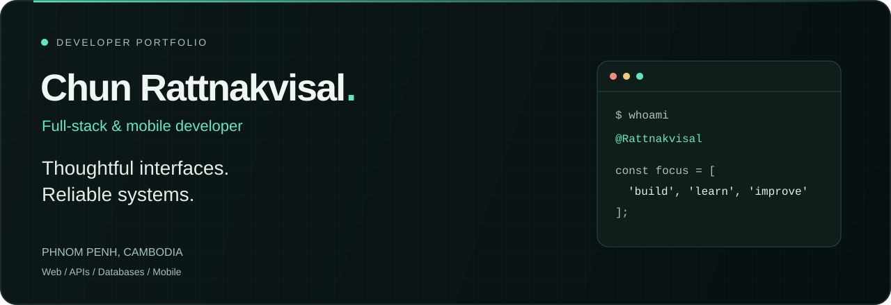
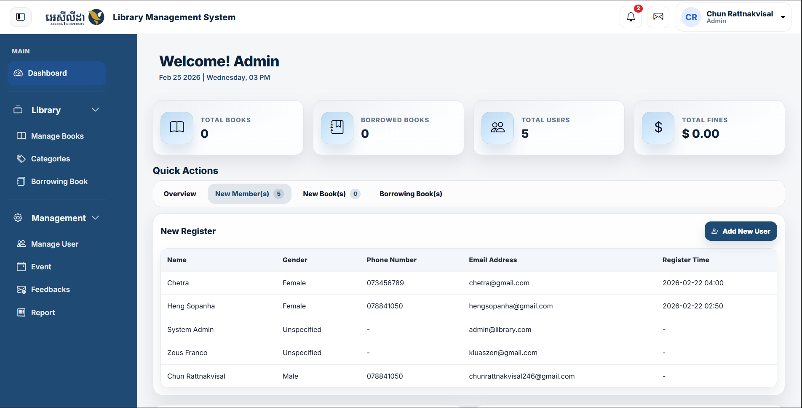
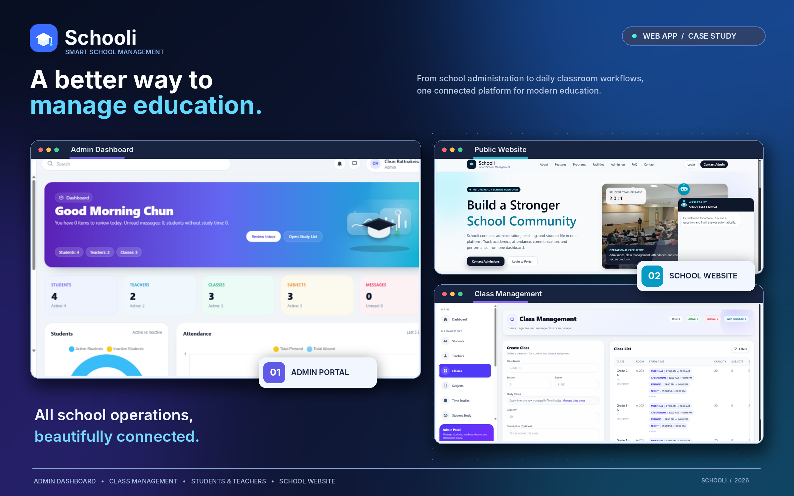
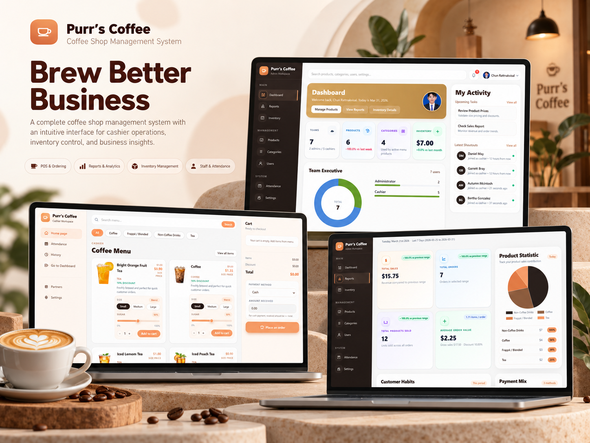
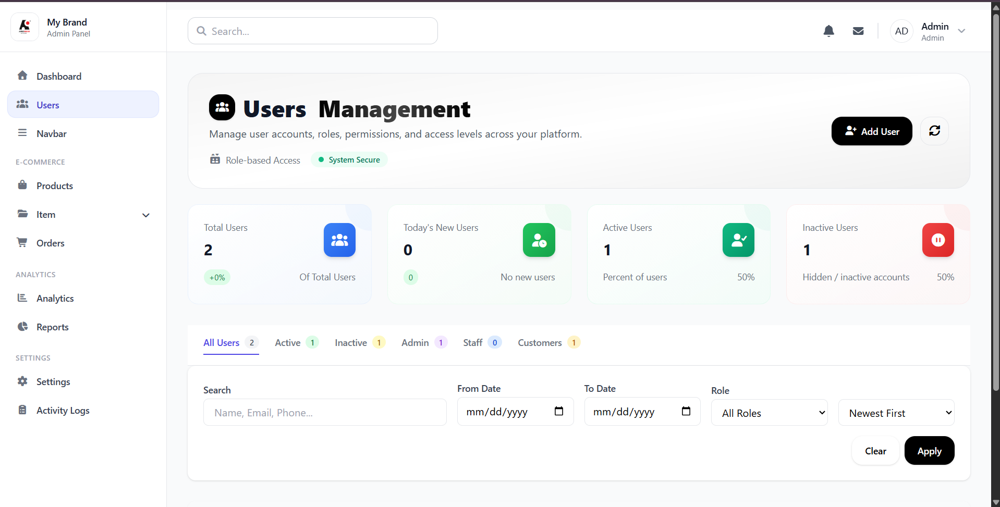
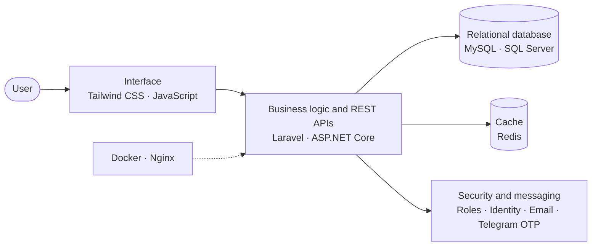
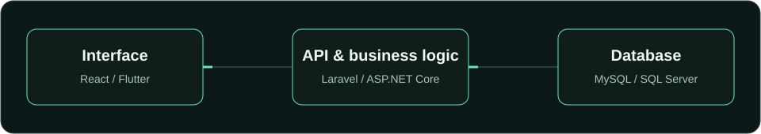
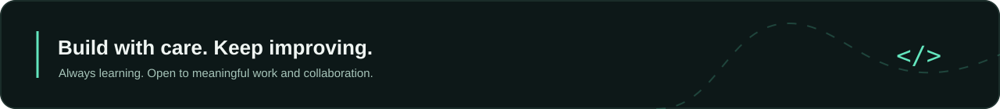

<!-- GitHub profile for Rattnakvisal (v2). Keep asset paths relative to this repository. -->

  

  

  
  
  

  
  

  <a href="#about">About</a> ·
  <a href="#featured-work">Featured work</a> ·
  <a href="#how-my-projects-fit-together">Architecture</a> ·
  <a href="#how-i-build">Approach</a> ·
  <a href="#toolkit">Toolkit</a> ·
  <a href="#currently-exploring">Learning</a> ·
  <a href="#github-stats">Stats</a> ·
  <a href="#lets-connect">Contact</a>

---

## About

<table>
<tr>
<td width="58%" valign="top">

**សួស្តី! 👋** Hi, I'm **Visal**, a Business Information Technology student at **ACLEDA University of Business** in Cambodia.

I build web applications, backend systems, and mobile interfaces, with a strong interest in how good design and clear data models work together.

My projects cover school operations, library workflows, coffee shop point of sale, and e-commerce. I enjoy connecting the pieces: a usable interface, well-structured business logic, and a database that fits the problem.

</td>
<td width="42%" valign="top">

| | |
| --- | --- |
| 🎓 **Studying** | Business Information Technology |
| 💼 **Experience** | Software Developer Intern, ACLEDA University of Business |
| 🛠️ **Focus** | Laravel, ASP.NET Core, REST APIs, database design |
| 🌱 **Learning** | Spring Boot, system design, CI/CD |
| 🤝 **Open to** | Junior roles, internships, collaboration |

</td>
</tr>
</table>

<table align="center">
<tr>
<td align="center" width="25%"><h3>4</h3>featured projects</td>
<td align="center" width="25%"><h3>2</h3>backend ecosystems Laravel · ASP.NET Core</td>
<td align="center" width="25%"><h3>1</h3>software developer internship</td>
<td align="center" width="25%"><h3>Web + Mobile</h3>React · Flutter</td>
</tr>
</table>

<strong>🇰🇭 អំពីខ្ញុំ (ជាភាសាខ្មែរ)</strong>

 

ខ្ញុំឈ្មោះ **វិសាល (Visal)** ជាសិស្សផ្នែក Business Information Technology នៅ ACLEDA University of Business។ ខ្ញុំបង្កើតកម្មវិធីគេហទំព័រ ប្រព័ន្ធ backend និងកម្មវិធីទូរស័ព្ទ ដោយផ្តោតលើចំណុចប្រទាក់ដែលងាយប្រើ និងរចនាសម្ព័ន្ធទិន្នន័យដែលច្បាស់លាស់។

ខ្ញុំបានបង្កើតគម្រោងប្រព័ន្ធគ្រប់គ្រងសាលារៀន ប្រព័ន្ធបណ្ណាល័យ ប្រព័ន្ធលក់ (POS) សម្រាប់ហាងកាហ្វេ និងហាងលក់ទំនិញអនឡាញ។ បច្ចុប្បន្នខ្ញុំកំពុងស្វែងរកឱកាសជា junior developer, internship និងការសហការលើគម្រោងផ្សេងៗ។

---

## Featured work

| Project | Problem it solves | Stack |
| --- | --- | --- |
| [**Library Management**](https://github.com/Rattnakvisal/Library-Management-system) | Catalog, borrowing, reservations, and fines for a library | ASP.NET Core · C# · EF Core · SQL Server |
| [**School Management**](https://github.com/Rattnakvisal/school-management-system) | One platform for admins, staff, teachers, and students | Laravel · MySQL · Tailwind CSS · Docker |
| [**Coffee POS**](https://github.com/Rattnakvisal/Coffee-System) | Checkout, inventory, and reports for a coffee shop | Laravel · MySQL · Redis · Docker |
| [**MyBrand E-Commerce**](https://github.com/Rattnakvisal/MyBrand_Ecommerce) | Storefront and admin dashboard for an online shop | PHP · MySQL · JavaScript · Tailwind CSS |

<table>
<tr>
<td width="50%" valign="top">

### 01 / Library Management &nbsp;⭐ Internship project

A library application built during my internship at ACLEDA University of Business.

- Book catalog, reservations, borrowing, returns, and fines
- Admin, librarian, and reader workflows
- Identity authentication, email confirmation, and reporting

 &nbsp;`EF Core` `SQL Server`

**[Explore repository →](https://github.com/Rattnakvisal/Library-Management-system)**

</td>
<td width="50%" valign="top">

### 02 / School Management

A school operations platform with workspaces for administrators, staff, teachers, and students.

- Classes, schedules, attendance, assignments, and grades
- Payments, reports, and PDF/Excel exports
- Role-based permissions and Telegram OTP authentication

**[Explore repository →](https://github.com/Rattnakvisal/school-management-system)**

</td>
</tr>
<tr>
<td width="50%" valign="top">

### 03 / Coffee POS

A point-of-sale and management application for everyday coffee shop operations.

- Admin dashboard for products, categories, inventory, and reports
- Cashier checkout, attendance, and order history
- Docker environment with Nginx, MySQL, and Redis

**[Explore repository →](https://github.com/Rattnakvisal/Coffee-System)**

</td>
<td width="50%" valign="top">

### 04 / MyBrand E-Commerce

A shopping platform connecting a customer storefront with an administration dashboard.

- Product browsing, cart, and checkout
- Order management and payment analytics
- PHP/PDO data access and a MySQL relational schema

**[Explore repository →](https://github.com/Rattnakvisal/MyBrand_Ecommerce)**

</td>
</tr>
</table>

  <a href="https://github.com/Rattnakvisal?tab=repositories">Browse all repositories →</a>
  &nbsp; · &nbsp;
  <a href="https://portfolio-gvmm.onrender.com/">Visit my portfolio website ↗</a>

---

## How my projects fit together

Most of my applications follow the same shape: an interface, a layer of business rules, and a database that matches the problem.

  

---

## How I build

| Step | What I focus on |
| --- | --- |
| **1. Model the data** | Thoughtful database relationships before writing features |
| **2. Shape the logic** | Clear validation and well-structured business rules |
| **3. Protect access** | Authentication and authorization, with role-based permissions |
| **4. Design the interface** | Responsive, usable screens for each type of user |
| **5. Package and ship** | Docker environments and readable, maintainable code |

---

## Toolkit

<table>
<tr>
<td width="110"><strong>Backend</strong></td>
<td> &nbsp;<code>REST APIs</code></td>
</tr>
<tr>
<td><strong>Frontend</strong></td>
<td></td>
</tr>
<tr>
<td><strong>Mobile</strong></td>
<td></td>
</tr>
<tr>
<td><strong>Data</strong></td>
<td> &nbsp;<code>Microsoft SQL Server</code></td>
</tr>
<tr>
<td><strong>Tools</strong></td>
<td> &nbsp;<code>Composer</code></td>
</tr>
</table>

---

## Currently exploring

| Topic | Focus |
| --- | --- |
| ☕ **Java and Spring Boot** | REST services and backend architecture |
| 🏗️ **System design and clean architecture** | Clearer boundaries between application concerns |
| ⚡ **PostgreSQL and Redis** | Query performance, indexing, and caching |
| 🚀 **Testing and delivery** | Automated checks, Docker, and CI/CD workflows |

---

## GitHub stats

  

<strong>More activity</strong>

 

  <picture>
    <source media="(prefers-color-scheme: dark)" srcset="https://github-readme-stats.vercel.app/api?username=Rattnakvisal&amp;show_icons=true&amp;theme=github_dark&amp;hide_border=true&amp;bg_color=0D1818&amp;title_color=63E6BE&amp;icon_color=63E6BE" />
    <source media="(prefers-color-scheme: light)" srcset="https://github-readme-stats.vercel.app/api?username=Rattnakvisal&amp;show_icons=true&amp;hide_border=true&amp;title_color=0F766E&amp;icon_color=0F766E" />
    
  </picture>
  <picture>
    <source media="(prefers-color-scheme: dark)" srcset="https://github-readme-stats.vercel.app/api/top-langs/?username=Rattnakvisal&amp;layout=compact&amp;theme=github_dark&amp;hide_border=true&amp;bg_color=0D1818&amp;title_color=63E6BE" />
    <source media="(prefers-color-scheme: light)" srcset="https://github-readme-stats.vercel.app/api/top-langs/?username=Rattnakvisal&amp;layout=compact&amp;hide_border=true&amp;title_color=0F766E" />
    
  </picture>

  <picture>
    <source media="(prefers-color-scheme: dark)" srcset="https://streak-stats.demolab.com/?user=Rattnakvisal&amp;theme=github-dark-blue&amp;hide_border=true&amp;background=0D1818&amp;ring=63E6BE&amp;fire=63E6BE&amp;currStreakLabel=63E6BE" />
    <source media="(prefers-color-scheme: light)" srcset="https://streak-stats.demolab.com/?user=Rattnakvisal&amp;hide_border=true&amp;ring=0F766E&amp;fire=0F766E&amp;currStreakLabel=0F766E" />
    
  </picture>

[View contributions and repositories directly on GitHub →](https://github.com/Rattnakvisal?tab=overview)

---

## Let's connect

I'm interested in opportunities where I can contribute to useful software, learn from other developers, and take care of the details.

<table>
<tr>
<td align="center" width="33%">

📧 **Email** 
<a href="mailto:rattnakvisalchun@gmail.com">rattnakvisalchun@gmail.com</a>

</td>
<td align="center" width="33%">

💼 **LinkedIn** 
<a href="https://www.linkedin.com/in/chun-rattnakvisal-3a24a0361/">Chun Rattnakvisal</a>

</td>
<td align="center" width="33%">

🌐 **Portfolio** 
<a href="https://portfolio-gvmm.onrender.com/">portfolio-gvmm.onrender.com</a>

</td>
</tr>
</table>

  

