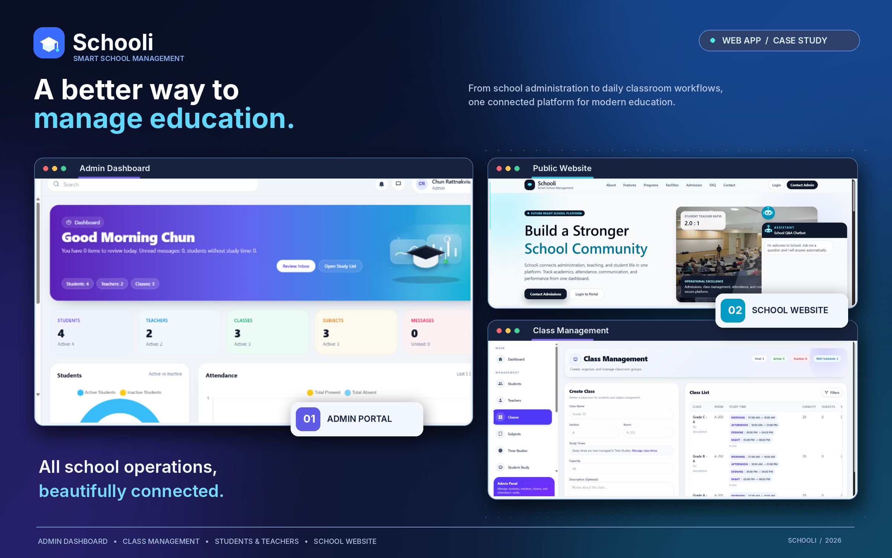

<!-- GitHub profile for Rattnakvisal. Keep the assets folder beside this file. -->

  <picture>
    <source media="(max-width: 600px)" srcset="./assets/banner-mobile.svg" />
    
  </picture>

  Building practical software with thoughtful interfaces and clear business logic.

  <a href="https://portfolio-gvmm.onrender.com/"><b>Portfolio ↗</b></a>
  &nbsp;&nbsp;·&nbsp;&nbsp;
  <a href="https://www.linkedin.com/in/chun-rattnakvisal-3a24a0361/"><b>LinkedIn ↗</b></a>
  &nbsp;&nbsp;·&nbsp;&nbsp;
  <a href="mailto:rattnakvisalchun@gmail.com"><b>Email me ↗</b></a>

  Phnom Penh, Cambodia &nbsp; / &nbsp; Open to junior roles, internships, and collaboration

---

## About me

**សួស្តី! I'm Visal**, a Business Information Technology student at **ACLEDA University of Business**. I build web applications, backend systems, and mobile apps, connecting the interface, application logic, and database into a useful product.

My work spans task management, education, library operations, retail, and e-commerce. I enjoy turning everyday workflows into software that is easier to use and maintain.

- **Experience:** Software Developer Intern at ACLEDA University of Business.
- **Core focus:** Laravel, ASP.NET Core, REST APIs, relational databases, and Flutter.
- **Growing in:** Java and Spring Boot, system design, automated testing, and CI/CD.

<b>អំពីខ្ញុំជាភាសាខ្មែរ</b>

ខ្ញុំឈ្មោះ **Chun Rattnakvisal (វិសាល)** ជានិស្សិតផ្នែក Business Information Technology នៅ **សាកលវិទ្យាល័យ អេស៊ីលីដា ពាណិជ្ជសាស្ត្រ**។ ខ្ញុំបង្កើតគេហទំព័រ ប្រព័ន្ធ backend និងកម្មវិធីទូរស័ព្ទ ដោយយកចិត្តទុកដាក់លើភាពងាយស្រួលប្រើ រចនាសម្ព័ន្ធទិន្នន័យ និងកូដដែលងាយថែទាំ។

គម្រោងរបស់ខ្ញុំរួមមានប្រព័ន្ធគ្រប់គ្រងកិច្ចការ សាលារៀន បណ្ណាល័យ ហាងកាហ្វេ និងហាងទំនិញអនឡាញ។ ខ្ញុំបើកចំហចំពោះឱកាសការងារ junior developer កម្មសិក្សា និងការសហការលើគម្រោង។

## Featured project

### [WorkMind — Task Manager](https://github.com/Rattnakvisal/Task-Manager)

A personal productivity app with a **Laravel web workspace** and a **Flutter Android app**. It brings tasks, calendars, priorities, and AI-assisted planning into one workflow.

- **Organize work:** Kanban, list, and grid views; due dates, priorities, and checklists.
- **Connect web and mobile:** Private user workspaces and Sanctum token authentication for the mobile API.
- **Plan with AI:** Gemini-powered assistance, task enhancement, and checklist breakdowns in English or Khmer.

<code>Laravel</code> &nbsp; <code>Flutter / Dart</code> &nbsp; <code>Tailwind CSS</code> &nbsp; <code>SQLite</code> &nbsp; <code>REST APIs</code> &nbsp; <code>Gemini</code>

## Selected work

<table>
<tr>
<td width="50%" valign="top">

### Library Management

INTERNSHIP PROJECT &nbsp; / &nbsp; ASP.NET CORE

A connected workflow for cataloging books, managing reservations, and tracking borrowing, returns, and fines.

- Admin, librarian, and reader workspaces
- Identity authentication and email confirmation
- Borrowing and fine collection reports

<code>C#</code> · <code>ASP.NET Core</code> · <code>EF Core</code> · <code>SQL Server</code>

**[Explore repository →](https://github.com/Rattnakvisal/Library-Management-system)**

</td>
<td width="50%" valign="top">

### School Management

EDUCATION PLATFORM &nbsp; / &nbsp; LARAVEL

A school operations platform with dedicated workspaces for administrators, staff, teachers, and students.

- Classes, attendance, assignments, and grades
- Payments, reports, and PDF/Excel exports
- Role-based access and Telegram OTP login

<code>Laravel</code> · <code>MySQL</code> · <code>Tailwind CSS</code> · <code>Docker</code>

**[Explore repository →](https://github.com/Rattnakvisal/school-management-system)**

</td>
</tr>
<tr>
<td width="50%" valign="top">

### Coffee POS

RETAIL OPERATIONS &nbsp; / &nbsp; LARAVEL

A coffee shop management system that connects cashier checkout with daily business reporting.

- Product options, discounts, and order history
- USD/KHR cash and manual KHQR confirmation
- Admin reports and cashier attendance

<code>Laravel</code> · <code>MySQL</code> · <code>Tailwind CSS</code> · <code>Docker</code>

**[Explore repository →](https://github.com/Rattnakvisal/Coffee-System)**

</td>
<td width="50%" valign="top">

### MyBrand E-Commerce

ONLINE STOREFRONT &nbsp; / &nbsp; PHP

An online shop connecting the customer shopping experience with an admin dashboard.

- Product browsing, cart, and checkout
- Order management and payment analytics
- Relational data access with PHP and PDO

<code>PHP</code> · <code>MySQL</code> · <code>JavaScript</code> · <code>Tailwind CSS</code>

**[Explore repository →](https://github.com/Rattnakvisal/MyBrand_Ecommerce)**

</td>
</tr>
</table>

  <a href="https://github.com/Rattnakvisal?tab=repositories"><b>Browse all repositories →</b></a>

## Technologies

| Area | Technologies I work with |
| :-- | :-- |
| **Backend** | PHP · Laravel · C# · ASP.NET Core · REST APIs |
| **Frontend** | JavaScript · TypeScript · React · HTML · CSS · Tailwind CSS · Bootstrap |
| **Mobile** | Flutter · Dart · Firebase |
| **Data** | MySQL · SQL Server · PostgreSQL · SQLite · Redis |
| **Tools** | Git · GitHub · Docker · Postman · Figma · Vite · Composer |

## How I approach a project

1. **Understand the workflow.** Identify who uses the system and what they need to accomplish.
2. **Design the foundation.** Model data relationships, validation, authentication, and permissions.
3. **Build the experience.** Connect responsive interfaces with clear application logic and APIs.
4. **Check and improve.** Test important behavior, review edge cases, and document setup.

<b>Current learning &amp; GitHub activity</b>

- **Java & Spring Boot:** REST services and backend architecture.
- **System design:** Clear boundaries between application responsibilities.
- **PostgreSQL & Redis:** Query performance, indexing, and caching.
- **Testing & delivery:** Automated checks, Docker, and CI/CD workflows.

[View my contributions and recent activity on GitHub →](https://github.com/Rattnakvisal?tab=overview)

## Let's connect

I'm looking for opportunities to contribute to useful software, learn from a team, and grow as a developer. If you're hiring for a **junior developer role**, offering an **internship**, or building a project we could work on together, I'd be happy to hear from you.

**[rattnakvisalchun@gmail.com](mailto:rattnakvisalchun@gmail.com)** &nbsp; · &nbsp; [LinkedIn](https://www.linkedin.com/in/chun-rattnakvisal-3a24a0361/) &nbsp; · &nbsp; [Portfolio](https://portfolio-gvmm.onrender.com/)

 

  

