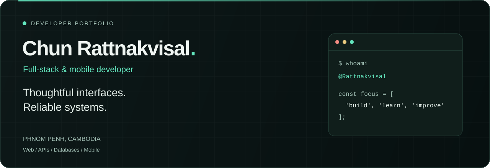
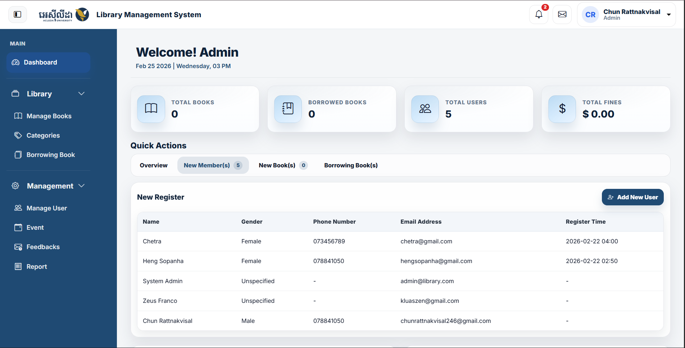
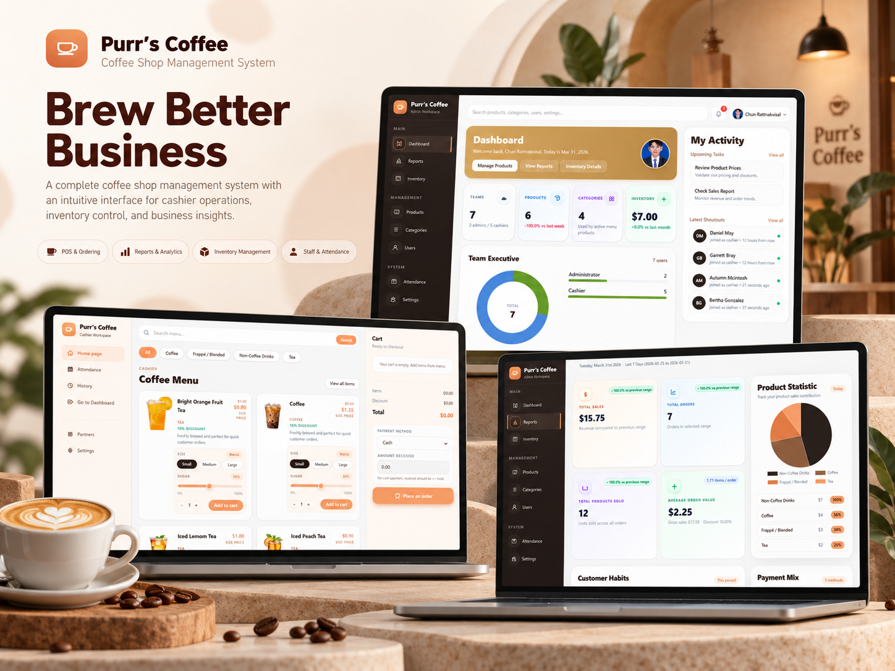
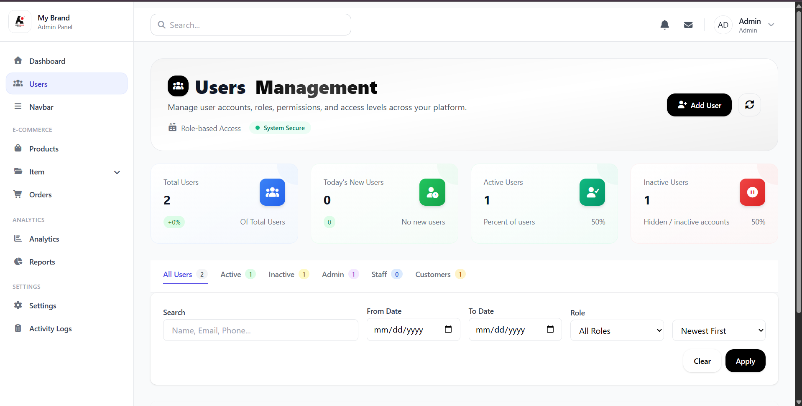
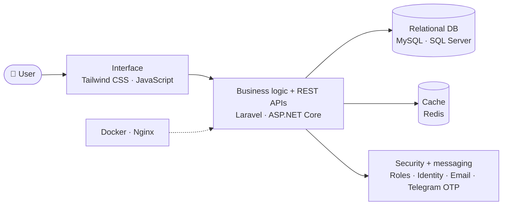
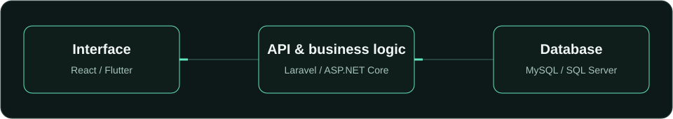
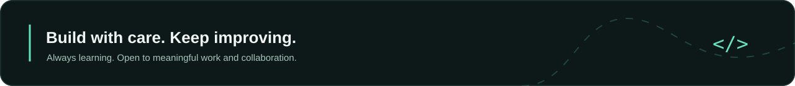

<!--
  GitHub profile README for Rattnakvisal (v3)
  - Asset paths (./assets/...) are relative to this repository.
  - Sections: Hero > Snapshot > About > Featured work > How I build > Tech stack > Learning > Stats > Contact
-->

<!-- ============================== HERO ============================== -->

  

  

  
  
  

  
  
  

  <a href="#about"><b>About</b></a> &nbsp;·&nbsp;
  <a href="#featured-work"><b>Projects</b></a> &nbsp;·&nbsp;
  <a href="#how-i-build"><b>Approach</b></a> &nbsp;·&nbsp;
  <a href="#tech-stack"><b>Stack</b></a> &nbsp;·&nbsp;
  <a href="#currently-learning"><b>Learning</b></a> &nbsp;·&nbsp;
  <a href="#github-stats"><b>Stats</b></a> &nbsp;·&nbsp;
  <a href="#contact"><b>Contact</b></a>

---

<!-- ============================== ABOUT ============================== -->

## About

<table>
<tr>
<td width="55%" valign="top">

**សួស្តី! 👋** I'm **Visal** (Chun Rattnakvisal), a Business Information Technology student at **ACLEDA University of Business** in Cambodia.

I build web applications, backend systems, and mobile interfaces. I care about how good design and clear data models work together.

My projects cover **school operations**, **library workflows**, **coffee shop point of sale**, and **e-commerce**. I like connecting the pieces: a usable interface, well-structured business logic, and a database that fits the problem.

</td>
<td width="45%" valign="top">

| Quick facts | |
| :-- | :-- |
| 🎓 **Studying** | Business Information Technology |
| 💼 **Experience** | Software Developer Intern, ACLEDA University of Business |
| 🛠️ **Focus** | Laravel · ASP.NET Core · REST APIs · Database design |
| 🌱 **Learning** | Spring Boot · System design · CI/CD |
| 📍 **Location** | Phnom Penh, Cambodia |

</td>
</tr>
</table>

  
  
  
  

<strong>🇰🇭 អំពីខ្ញុំ (ជាភាសាខ្មែរ)</strong>

 

ខ្ញុំឈ្មោះ **វិសាល (Visal)** ជាសិស្សផ្នែក Business Information Technology នៅ ACLEDA University of Business។ ខ្ញុំបង្កើតកម្មវិធីគេហទំព័រ ប្រព័ន្ធ backend និងកម្មវិធីទូរស័ព្ទ ដោយផ្តោតលើចំណុចប្រទាក់ដែលងាយប្រើ និងរចនាសម្ព័ន្ធទិន្នន័យដែលច្បាស់លាស់។

ខ្ញុំបានបង្កើតគម្រោងប្រព័ន្ធគ្រប់គ្រងសាលារៀន ប្រព័ន្ធបណ្ណាល័យ ប្រព័ន្ធលក់ (POS) សម្រាប់ហាងកាហ្វេ និងហាងលក់ទំនិញអនឡាញ។ បច្ចុប្បន្នខ្ញុំកំពុងស្វែងរកឱកាសជា junior developer, internship និងការសហការលើគម្រោងផ្សេងៗ។

---

<!-- ============================ FEATURED WORK ============================ -->

## Featured work

<table>
<tr>
<!-- ---------- 01 · Library ---------- -->
<td width="50%" valign="top">

### 📚 Library Management
<b>Internship project</b> · ASP.NET Core

**Problem:** manage a library's catalog, borrowing, reservations, and fines in one place.

- Catalog, reservations, borrowing, returns, and fines
- Separate admin, librarian, and reader workflows
- Identity authentication, email confirmation, and reporting

 
<code>EF Core</code> · <code>SQL Server</code>

<a href="https://github.com/Rattnakvisal/Library-Management-system"><b>View repository →</b></a>
 

</td>
<!-- ---------- 02 · School ---------- -->
<td width="50%" valign="top">

### 🏫 School Management
<b>Multi-role platform</b> · Laravel

**Problem:** give admins, staff, teachers, and students one connected workspace.

- Classes, schedules, attendance, assignments, and grades
- Payments, reports, and PDF/Excel exports
- Role-based permissions and Telegram OTP login

<a href="https://github.com/Rattnakvisal/school-management-system"><b>View repository →</b></a>
 

</td>
</tr>
<tr>
<!-- ---------- 03 · Coffee ---------- -->
<td width="50%" valign="top">

### ☕ Coffee POS
<b>Point of sale</b> · Laravel

**Problem:** run checkout, inventory, and reporting for a coffee shop.

- Admin dashboard for products, categories, inventory, and reports
- Cashier checkout, attendance, and order history
- Dockerized with Nginx, MySQL, and Redis

<a href="https://github.com/Rattnakvisal/Coffee-System"><b>View repository →</b></a>
 

</td>
<!-- ---------- 04 · E-commerce ---------- -->
<td width="50%" valign="top">

### 🛍️ MyBrand E-Commerce
<b>Online shop</b> · PHP

**Problem:** connect a customer storefront with an admin dashboard.

- Product browsing, cart, and checkout
- Order management and payment analytics
- PHP/PDO data access with a MySQL relational schema

<a href="https://github.com/Rattnakvisal/MyBrand_Ecommerce"><b>View repository →</b></a>
 

</td>
</tr>
</table>

  <a href="https://github.com/Rattnakvisal?tab=repositories"><b>Browse all repositories →</b></a>
  &nbsp;·&nbsp;
  <a href="https://portfolio-gvmm.onrender.com/"><b>Visit my portfolio ↗</b></a>

### Architecture at a glance

Most of my applications share the same shape: an interface, a layer of business rules, and a database that matches the problem.

---

<!-- ============================== APPROACH ============================== -->

## How I build

<table>
<tr>
<td align="center" width="20%"><h3>1</h3><b>Model the data</b> Database relationships before features</td>
<td align="center" width="20%"><h3>2</h3><b>Shape the logic</b> Clear validation and business rules</td>
<td align="center" width="20%"><h3>3</h3><b>Protect access</b> Authentication, roles, permissions</td>
<td align="center" width="20%"><h3>4</h3><b>Design the UI</b> Responsive screens for each user type</td>
<td align="center" width="20%"><h3>5</h3><b>Package &amp; ship</b> Docker and maintainable code</td>
</tr>
</table>

  

---

<!-- ============================== TECH STACK ============================== -->

## Tech stack

<table>
<tr>
<td width="120"><b>Backend</b></td>
<td>
  
  &nbsp;<code>REST APIs</code>
</td>
</tr>
<tr>
<td><b>Frontend</b></td>
<td></td>
</tr>
<tr>
<td><b>Mobile</b></td>
<td></td>
</tr>
<tr>
<td><b>Databases</b></td>
<td>
  
  &nbsp;<code>Microsoft SQL Server</code>
</td>
</tr>
<tr>
<td><b>Tools</b></td>
<td>
  
  &nbsp;<code>Composer</code>
</td>
</tr>
</table>

---

<!-- ============================== LEARNING ============================== -->

## Currently learning

| | Topic | What I'm working on |
| :-: | :-- | :-- |
| ☕ | **Java & Spring Boot** | REST services and backend architecture |
| 🏗️ | **System design & clean architecture** | Clearer boundaries between application concerns |
| ⚡ | **PostgreSQL & Redis** | Query performance, indexing, and caching |
| 🚀 | **Testing & delivery** | Automated checks, Docker, and CI/CD workflows |

---

<!-- ============================== STATS ============================== -->

## GitHub stats

  

<strong>📊 More activity</strong>

 

  <picture>
    <source media="(prefers-color-scheme: dark)" srcset="https://github-readme-stats.vercel.app/api?username=Rattnakvisal&amp;show_icons=true&amp;theme=github_dark&amp;hide_border=true&amp;bg_color=0D1818&amp;title_color=63E6BE&amp;icon_color=63E6BE" />
    <source media="(prefers-color-scheme: light)" srcset="https://github-readme-stats.vercel.app/api?username=Rattnakvisal&amp;show_icons=true&amp;hide_border=true&amp;title_color=0F766E&amp;icon_color=0F766E" />
    
  </picture>
  <picture>
    <source media="(prefers-color-scheme: dark)" srcset="https://github-readme-stats.vercel.app/api/top-langs/?username=Rattnakvisal&amp;layout=compact&amp;theme=github_dark&amp;hide_border=true&amp;bg_color=0D1818&amp;title_color=63E6BE" />
    <source media="(prefers-color-scheme: light)" srcset="https://github-readme-stats.vercel.app/api/top-langs/?username=Rattnakvisal&amp;layout=compact&amp;hide_border=true&amp;title_color=0F766E" />
    
  </picture>

  <picture>
    <source media="(prefers-color-scheme: dark)" srcset="https://streak-stats.demolab.com/?user=Rattnakvisal&amp;theme=github-dark-blue&amp;hide_border=true&amp;background=0D1818&amp;ring=63E6BE&amp;fire=63E6BE&amp;currStreakLabel=63E6BE" />
    <source media="(prefers-color-scheme: light)" srcset="https://streak-stats.demolab.com/?user=Rattnakvisal&amp;hide_border=true&amp;ring=0F766E&amp;fire=0F766E&amp;currStreakLabel=0F766E" />
    
  </picture>

  <a href="https://github.com/Rattnakvisal?tab=overview">View contributions on GitHub →</a>

---

<!-- ============================== CONTACT ============================== -->

## Contact

I'm looking for opportunities where I can contribute to useful software, learn from other developers, and take care of the details.

<table>
<tr>
<td align="center" width="33%">
  📧 <b>Email</b> 
  <a href="mailto:rattnakvisalchun@gmail.com">rattnakvisalchun@gmail.com</a>
</td>
<td align="center" width="33%">
  💼 <b>LinkedIn</b> 
  <a href="https://www.linkedin.com/in/chun-rattnakvisal-3a24a0361/">Chun Rattnakvisal</a>
</td>
<td align="center" width="33%">
  🌐 <b>Portfolio</b> 
  <a href="https://portfolio-gvmm.onrender.com/">portfolio-gvmm.onrender.com</a>
</td>
</tr>
</table>

  

